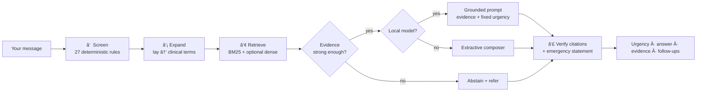

<div align="center">

# SymptomPilot AI

**Local-first, evidence-grounded symptom triage — with citations you can check.**

Describe a symptom. Get an urgency level, a plain-language answer, and the exact evidence behind it.
No API keys, no cloud vector database, no build step.

[](https://github.com/abubakarsiddique360/SymptomPilot-AI/actions/workflows/ci.yml)
[](pyproject.toml)
[](tests)
[](pyproject.toml)
[](LICENSE)

</div>

> [!WARNING]
> **Educational triage aid — not a medical device.** SymptomPilot cannot diagnose,
> rule out, or treat any condition, and it is not clinically validated. In an
> emergency, contact your local emergency number immediately. Never send real
> patient data to a third-party model endpoint.

---

## Why this project exists

Most medical chatbot demos are a prompt wrapped around a vector database. That
design hides two problems: the urgency advice is generated text (so it can be
talked out of an escalation), and the answers are unverifiable prose.

SymptomPilot separates those concerns:

| | Typical demo | SymptomPilot |
| --- | --- | --- |
| Urgency | Suggested by the model | **Deterministic rules engine** that runs before any model |
| Evidence | Links in passing | `[S1]` markers validated against the passages actually retrieved |
| No evidence available | Model improvises | Explicit **abstention** with a clinician referral |
| Dependencies | LLM API + hosted vector DB | `pip install` only; SQLite + pure-Python BM25 |
| Without credentials | Broken | Full quality via an extractive composer |
| Quality control | Manual spot checks | **18-case offline evaluation** with a hard emergency-recall gate |

## Quick start

```bash
git clone https://github.com/abubakarsiddique360/SymptomPilot-AI.git
cd SymptomPilot-AI

python -m venv .venv
# Windows: .venv\Scripts\activate     macOS/Linux: source .venv/bin/activate
pip install -e ".[dev]"

python -m symptompilot serve
```

Open <http://127.0.0.1:8000>. That is the whole setup — no keys, no model download,
no migration step. The first start indexes the bundled knowledge base into
`var/symptompilot.db`.

Try the terminal instead:

```bash
python -m symptompilot ask "I have had a high fever for four days with chills"
python -m symptompilot eval
```

### Optional: use a local model

The extractive composer is honest but plain. For natural prose, run a model
locally — nothing leaves the machine:

```bash
ollama pull llama3.2
python -m symptompilot serve        # picked up automatically
```

Any OpenAI-compatible endpoint works too (vLLM, LM Studio, a gateway):

```bash
export SYMPTOMPILOT_LLM_PROVIDER=openai
export SYMPTOMPILOT_OPENAI_BASE_URL=http://127.0.0.1:1234/v1
export SYMPTOMPILOT_OPENAI_API_KEY=not-needed
export SYMPTOMPILOT_OPENAI_MODEL=local-model
```

If the provider disappears mid-request, the answer falls back to the extractive
composer and reports `mode: "extractive:llm-error"` — degraded, never empty.

## How it works



1. **Screen** — regular-expression rules over normalised text produce a red-flag
   list and an urgency level. Negation-aware ("no chest pain" does not escalate)
   and compound-aware (fever **and** stiff neck does).
2. **Expand** — each query token becomes a concept group with lay synonyms, so
   "burning when I pee" reaches a page written with "urine".
3. **Retrieve** — Okapi BM25 with IDF-weighted concept coverage, optionally fused
   with Ollama embeddings and cosine similarity.
4. **Verify** — citation markers without a matching passage are stripped; an
   emergency response that forgot to say "emergency" gets the statement added.

Deeper detail: [architecture](docs/architecture.md) · [safety model](docs/safety.md) · [retrieval](docs/architecture.md#retrieval-scoring).

## CLI

| Command | What it does |
| --- | --- |
| `symptompilot serve` | Run the web app and API (`--host`, `--port`, `--reload`) |
| `symptompilot ask "..."` | One-shot triage in the terminal (`--json`) |
| `symptompilot ingest` | Sync SQLite with `knowledge/` (`--embed` adds dense vectors) |
| `symptompilot topics` | List indexed pages |
| `symptompilot eval` | Run the offline evaluation suite (`--json`) |

All commands accept `--kb DIR` and `--db PATH` to point at a different corpus or
database.

## API

| Method | Endpoint | Purpose |
| --- | --- | --- |
| `GET` | `/api/health` | Mode, provider, document/chunk counts |
| `POST` | `/api/triage` | Full triage response (urgency, answer, citations, follow-ups) |
| `POST` | `/api/triage/stream` | Same, streamed as Server-Sent Events (`meta`, `token`, `done`) |
| `POST` | `/api/search` | Raw retrieval, for debugging ranking |
| `GET` | `/api/topics` | Knowledge-base catalogue |
| `GET` | `/api/topics/{id}` | One page with its markdown body |
| `GET` | `/docs` | Interactive OpenAPI documentation |

```bash
curl -s http://127.0.0.1:8000/api/triage \
  -H "Content-Type: application/json" \
  -d '{"message": "My baby is two months old and has a fever"}' | jq '{urgency: .urgency.level, mode, citations: (.citations | length)}'
```

```json
{ "urgency": "emergency", "mode": "extractive", "citations": 3 }
```

## Evaluation

```bash
$ python -m symptompilot eval
metric                     value
------------------------   -----
level_accuracy             1.00
retrieval_hit_rate         1.00
emergency_recall           1.00
abstain_accuracy           1.00
```

`emergency_recall` is gated at **1.00**: one missed emergency fails CI. The
18 cases are curated regression tests, not clinical validation — see
[evaluation docs](docs/evaluation.md).

## Knowledge base

14 original pages live in [`knowledge/`](knowledge), each with frontmatter and
public-health references (WHO, CDC, NHS). Adding a page is a markdown file plus a
re-index:

```markdown
---
id: my-topic
title: My topic
topic: General
summary: One sentence.
tags: [example]
sources:
  - title: Source name
    url: https://example.org
    publisher: Example
---

## Overview

Your own words.
```

Then `python -m symptompilot ingest`. Format rules and writing guidance:
[knowledge-base docs](docs/knowledge-base.md).

## Configuration

Everything is optional; every value has a working default. See
[`.env.example`](.env.example).

| Variable | Default | Purpose |
| --- | --- | --- |
| `SYMPTOMPILOT_LLM_PROVIDER` | `auto` | `auto`, `ollama`, `openai`, `none` |
| `SYMPTOMPILOT_OLLAMA_URL` / `_MODEL` | `http://127.0.0.1:11434` / `llama3.2` | Local model |
| `SYMPTOMPILOT_OPENAI_BASE_URL` / `_API_KEY` / `_MODEL` | OpenAI defaults | Any compatible endpoint |
| `SYMPTOMPILOT_EMBED_BACKEND` / `_MODEL` | `auto` / `nomic-embed-text` | Optional dense retrieval |
| `SYMPTOMPILOT_BM25_WEIGHT` | `0.65` | Lexical share of the fused score |
| `SYMPTOMPILOT_ABSTAIN_THRESHOLD` | `0.15` | Below this, the assistant abstains |
| `SYMPTOMPILOT_TOP_K` | `5` | Passages retrieved per question |
| `SYMPTOMPILOT_DB_PATH` / `_KB_DIR` | `var/symptompilot.db` / `knowledge` | Storage locations |

## Docker

```bash
docker build -t symptompilot:local .
docker run --rm -p 8000:8000 symptompilot:local          # offline extractive mode

docker compose --profile llm up --build                  # with a local Ollama service
```

The image runs as a non-root user and exposes a `/api/health` health check.

## Project layout

```text
src/symptompilot/
├── api.py            FastAPI app, SSE streaming, static assets
├── cli.py            serve · ingest · ask · topics · eval
├── config.py         immutable settings from SYMPTOMPILOT_* env vars
├── runtime.py        dependency wiring (store → retriever → agent)
├── models.py         shared Pydantic models
├── agent/            orchestrator, extractive composer, verifier, prompts
├── retrieval/        BM25, chunker, SQLite store, expansion, hybrid fusion
├── safety/           rules.yaml + negation-aware screener
├── llm/              Ollama and OpenAI-compatible clients
├── evaluation/       golden cases + metrics runner
└── web/              single-page UI (HTML/CSS/vanilla JS)
knowledge/            14 cited pages
tests/                84 pytest tests
```

## Safety and limitations

Read the full [safety model](docs/safety.md). The short version:

- No diagnosis, no dosages, no "this rules out" statements — enforced in both the
  prompt and the offline composer.
- Urgency is decided by auditable rules, never by generated text, so retrieved
  text and prompt injection cannot downgrade an emergency.
- Answers cite `[S#]` evidence or abstain; unsupported markers are removed before
  display.
- No authentication and no rate limiting — bind to `127.0.0.1` or put it behind
  your own proxy.
- English only; rule coverage is finite; the emergency numbers shown are examples,
  not a lookup of your country.

## Roadmap

- [ ] Multilingual messages with language-matched responses
- [ ] Optional paediatric and pregnancy rule packs
- [ ] Retrieval benchmark with adversarial "near-miss" questions
- [ ] Server-side conversation store with retention controls (opt-in)
- [ ] Accessibility audit of the web UI

## Contributing

Issues and pull requests are welcome — start with
[CONTRIBUTING.md](CONTRIBUTING.md) and the
[Code of Conduct](CODE_OF_CONDUCT.md). For anything security related, follow
[SECURITY.md](SECURITY.md) and report privately.

```bash
python -m ruff check . && python -m ruff format --check . && python -m pytest && python -m symptompilot eval
```

## License

[MIT](LICENSE) © 2026 **ABU BAKAR SIDDIQUE**

The bundled knowledge-base prose was written for this project and paraphrases
public guidance; each page links its sources. The software is provided "as is",
without warranty of any kind, and is not a substitute for professional medical
advice.
