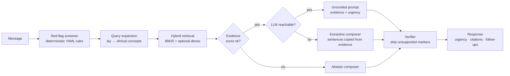

# Architecture

SymptomPilot is a small, deliberately boring pipeline. There is no vector
database, no orchestration framework and no JavaScript build step: the whole
runtime is FastAPI + SQLite + the Python standard library, with one optional HTTP
call to a language model.

## Request lifecycle



The screener runs **before** anything else, so the urgency a user sees is never a
product of generated text. Retrieval, composition and verification can all fail
without changing that guarantee.

## Modules

| Path | Responsibility |
| --- | --- |
| `config.py` | Immutable `Settings`, built from `SYMPTOMPILOT_*` environment variables; every value has a working default. |
| `models.py` | Pydantic models shared by the API, CLI and tests (`TriageRequest`, `TriageResponse`, `Passage`, `Citation`, `Urgency`). |
| `retrieval/kb.py` | Loads markdown pages with YAML frontmatter; validates ids and required metadata. |
| `retrieval/chunker.py` | Splits pages into heading-aware chunks so a citation can name a section. |
| `retrieval/store.py` | SQLite persistence (`documents`, `chunks`, `vectors`), idempotent sync driven by content checksums. |
| `retrieval/bm25.py` | Dependency-free Okapi BM25 plus IDF-weighted concept coverage and saturation. |
| `retrieval/expansion.py` | Maps lay words ("pee", "tummy", "hurts") onto clinical vocabulary as concept groups. |
| `retrieval/hybrid.py` | Fuses lexical and optional dense scores; reloads the in-memory index from SQLite. |
| `retrieval/embedder.py` | Optional Ollama embeddings and a pure-Python cosine helper. |
| `safety/redflags.py` | Loads `rules.yaml`, normalises text, applies negation and compound matching, returns urgency. |
| `agent/orchestrator.py` | The pipeline: screen → retrieve → prioritise → compose → verify. |
| `agent/composer.py` | Deterministic answer builder used when no LLM is available. |
| `agent/verifier.py` | Removes citation markers without evidence and enforces the emergency statement. |
| `llm/` | Thin clients for Ollama and any OpenAI-compatible endpoint, plus provider resolution. |
| `evaluation/` | Golden cases and the offline metrics runner. |
| `api.py` | FastAPI app factory, SSE streaming, static assets. |
| `cli.py` | `serve`, `ingest`, `ask`, `topics`, `eval`. |
| `web/` | Single-page UI: HTML, CSS, vanilla JS. |

## Retrieval scoring

Each query token becomes a concept group (the token plus known synonyms). A chunk
score is:

```text
saturation = raw_bm25 / (raw_bm25 + 3)
coverage   = Σ idf(matched concepts) / Σ idf(all concepts)
lexical    = coverage × saturation
fused      = bm25_weight × lexical + (1 − bm25_weight) × cosine(query, chunk)
```

Two properties matter:

- **Saturation** keeps BM25 values comparable between queries, so a single
  absolute threshold (`SYMPTOMPILOT_ABSTAIN_THRESHOLD`) can decide when to
  abstain. Normalising by the best score in the result set — the obvious
  alternative — makes every query look confident, because the top hit is always
  `1.0`.
- **Coverage** penalises documents that match one incidental word out of five.
  This is what stops "what is the boiling point of water" from matching the
  rehydration page, which contains the word "water".

Dense retrieval is additive. `symptompilot ingest --embed` writes vectors with a
local Ollama embedding model; if the model is missing, search silently uses BM25
only.

## Design decisions and trade-offs

| Decision | Why | Cost |
| --- | --- | --- |
| SQLite instead of a vector service | Zero infrastructure, offline-first, trivially inspectable | Single-writer; fine for one process, not for horizontal scale |
| In-memory BM25 rebuilt at startup | Hundreds of chunks load in milliseconds | Rebuild cost grows linearly with corpus size |
| Deterministic screener before the model | Urgency cannot be prompt-injected away | Rules need maintenance and explicit negation tests |
| Extractive fallback instead of "no model, no answer" | The project must run with no keys and no downloads | Extractive prose is plainer than generated prose |
| Citation markers verified after generation | Unsupported claims become visible instead of invisible | A model that cites badly produces a terse answer |
| Vanilla JS with no bundler | `pip install` is the only setup step | No component ecosystem |

## Failure modes

| Failure | Behaviour |
| --- | --- |
| Ollama not running, or model not pulled | Provider resolution returns `None`; extractive composition is used |
| LLM reachable but the call fails | `LLMError` is caught, extractive fallback runs, mode reports `extractive:llm-error` |
| Embedding backend unavailable | Dense scores are skipped; BM25 answers alone |
| Empty or missing knowledge directory | The service starts with zero documents and every answer abstains |
| Question outside the corpus | Response has `abstained: true`, no citations, and a clinician referral |

## Extending

- **New knowledge page:** add markdown to `knowledge/`, run `ingest`, add an
  evaluation case. See [knowledge-base.md](knowledge-base.md).
- **New warning sign:** add a rule to `safety/rules.yaml` plus a negation test.
  See [safety.md](safety.md).
- **New model provider:** implement the two-method protocol in `llm/base.py`
  (`available`, `complete`) and register it in `llm/__init__.py`.
